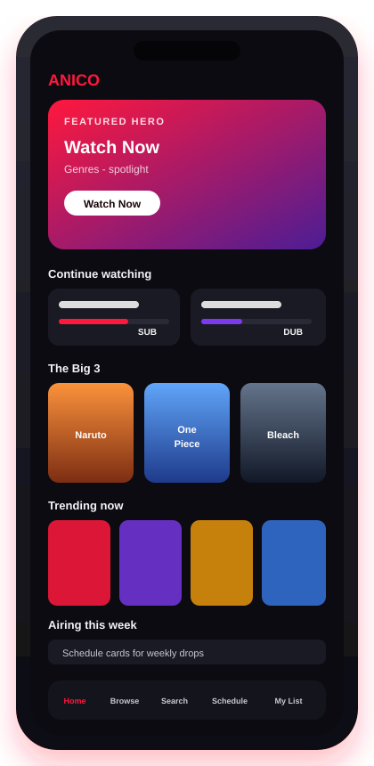

# ANICO — Watch Anime Free with This Anime Streaming App

**ANICO** is an anime streaming app for Android. You can watch anime free: the app is free to install, with SUB and DUB playback, continue watching, a watchlist, and a weekly anime schedule, in a dark cinematic interface.

 

[-111118?style=for-the-badge&labelColor=1a0508)](https://anico-website.pages.dev/#download)

## Anime streaming features

The public site describes these parts of the app.

<table>
  <tr>
    <td width="33%" valign="top" align="center">
      <h3>🔍 Discover anime</h3>
      Browse by genre, year, type, and language. Popular seasons and new releases are shown at a glance.
    </td>
    <td width="33%" valign="top" align="center">
      <h3>🗣️ Sub and dub</h3>
      Switch audio when dubs are available. Subtitles and language options are offered per episode.
    </td>
    <td width="33%" valign="top" align="center">
      <h3>⏯️ Continue watching</h3>
      Resume where you left off. Progress stays on your device automatically.
    </td>
  </tr>
  <tr>
    <td width="33%" valign="top" align="center">
      <h3>⭐ Smart watchlist</h3>
      Save favorites and build your queue. Sign in when you want sync across devices.
    </td>
    <td width="33%" valign="top" align="center">
      <h3>📅 Anime schedule</h3>
      See what airs next and plan your week with the in-app calendar.
    </td>
    <td width="33%" valign="top" align="center">
      <h3>🎬 Premium player</h3>
      Fullscreen playback, seek, quality options, and controls built for long sessions.
    </td>
  </tr>
</table>

HD streaming · regular updates · optional sign-in

## App preview

A phone-frame concept of the home screen sections the site describes. It is a layout mockup, not a captured screenshot.

## Why ANICO

What the site actually emphasizes.

<table>
  <tr>
    <td width="50%" valign="top" align="center">
      <h3>🌙 One home screen</h3>
      Featured picks, continue watching, trending, and the weekly schedule live together.
    </td>
    <td width="50%" valign="top" align="center">
      <h3>🗣️ SUB and DUB</h3>
      Switch audio when a dub exists, with subtitles and language options per episode.
    </td>
  </tr>
  <tr>
    <td width="50%" valign="top" align="center">
      <h3>⏯️ Your place is saved</h3>
      Continue-watching progress stays on the device. Sign in only if you want sync.
    </td>
    <td width="50%" valign="top" align="center">
      <h3>💸 Free to install</h3>
      The site lists the offer price as $0. Android only. There is no iOS build.
    </td>
  </tr>
</table>

## Watch anime on the home screen

| | |
| --- | --- |
| 🎬 **Featured hero** | Cinematic spotlight with ratings, genres, and one-tap Watch Now. |
| ⏯️ **Continue watching** | Episodes with progress bars, SUB/DUB labels, and quick actions. |
| 🏆 **The Big 3** | Legendary rows for iconic series, curated for discovery. |
| 🔥 **Trending now** | Ranked posters and fresh episodes. |
| 📅 **Airing this week** | Schedule-aware cards for simulcasts and weekly drops. |
| 📱 **Bottom navigation** | Home, Browse, Search, Schedule, and My List. |

## Popular anime

Tribute row on the home feed for **The Big Three**. Catalog availability varies by region.

| Series | Line from the app |
| --- | --- |
| 🟠 **Naruto** | A ninja's dream never ends. |
| 🔵 **One Piece** | The greatest treasure is freedom. |
| ⚪ **Bleach** | Protect what you believe in. |

## Roadmap

| Status | What the site says |
| --- | --- |
| ⏳ **Coming soon** | The Android APK. The link is configured from the ANICO Admin app, Website tab. |

## Anime app FAQ

<strong>What is ANICO?</strong>

ANICO is an Android anime streaming app focused on discovery, playback, and schedule, with a dark cinematic interface.

<strong>Is ANICO free?</strong>

The app is free to install. Optional account sign-in is available. Browsing and watching do not require social login. The site lists the offer price as $0.

<strong>Which devices are supported?</strong>

Android only. There is no iOS build at this time.

<strong>Does ANICO support subtitles and dubs?</strong>

Episodes support SUB playback. DUB is shown when it is available for that episode. The player also offers subtitles and language options per episode.

<strong>Can I create a watchlist?</strong>

My List is in the bottom navigation. You can save favorites and build a queue, and continue-watching progress stays on your device. Optional sign-in syncs your profile across sessions.

<strong>How do I install it?</strong>

Use Download for Android on [anico-website.pages.dev](https://anico-website.pages.dev/). The download section currently says **Coming soon** until an APK link is published. When it is published, download the APK, allow installs from unknown sources if prompted, and open the file to install.

<strong>How can I contact support?</strong>

Email [support@anico.app](mailto:support@anico.app).

## Star history

Live GitHub star history for this repository. It is not an app rating.

## Share ANICO

 

**ANICO** · Anime lives here. Your anime. Your universe.

[Website](https://anico-website.pages.dev/) · [Privacy Policy](https://anico-website.pages.dev/privacy) · [Terms of Service](https://anico-website.pages.dev/terms) · [support@anico.app](mailto:support@anico.app)

© 2026 ANICO

